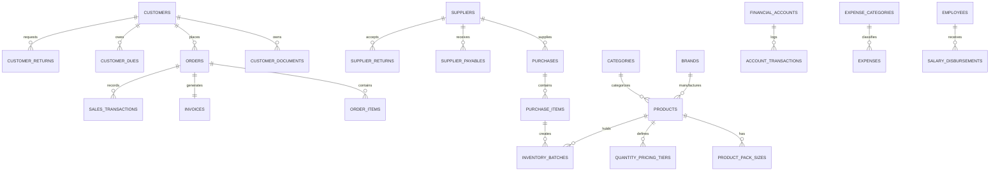
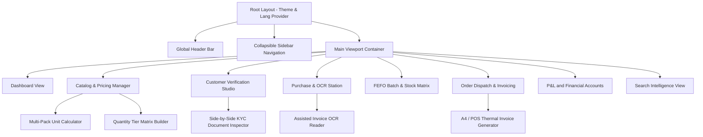

# CONFIDENCE PHARMA — B2B Healthcare & Business Marketplace
## Admin Panel Full Demo Database & UI Architecture Plan

> **Document Version:** 1.0.0  
> **Prepared for:** Confidence Pharma (Dr. TC Dey)  
> **Prepared by:** Antigravity Engineering Architecture Team  
> **Target System:** Next.js + Tailwind CSS Web Admin Panel / PostgreSQL Database  
> **Scope Alignment:** Final Development Proposal & Master SRS  

---

## 1. Executive Summary & Architectural Vision

Confidence Pharma is an advanced **B2B Healthcare & Business Marketplace and Business Management Platform** designed exclusively for verified healthcare entities (Pharmacies, Clinics, Diagnostic Centers, Hospitals, Surgical stores, and healthcare businesses). 

### 1.1 Core Strategic Principles
1. **Single-Vendor Launch with Multi-Vendor / Multi-Branch Core Architecture:**  
   The initial operational phase operates under a centralized single-distributor model. However, the database schema and API contracts are structured from Day 1 with multi-branch, multi-warehouse, and vendor isolation keys (`warehouse_id`, `vendor_id`, `branch_id`) to ensure zero-rewrite scalability when transitioning to a full multi-vendor marketplace or distributed warehouse network.
2. **Management Accounting Integration:**  
   Unlike superficial ecommerce portals, Confidence Pharma unifies Order Processing, Inventory Batch Tracking (FEFO), Supplier Payables, Customer Receivables, Operating Expenses, Payroll, Cash/Bank/MFS reconciliation, and Real-time Profit & Loss (COGS based on Weighted Average Cost).
3. **Audit-Safe KYC Verification:**  
   Access is strictly restricted to verified business entities. Super Admin overrides are backed by immutable audit logging requiring justification.
4. **B2B Purchasing Dynamics:**  
   Supports multi-pack conversions (Tablet $\leftrightarrow$ Strip $\leftrightarrow$ Box), tiered quantity-based pricing (wholesale volume discounts), and assisted OCR purchase invoice entry.
5. **Localization:**  
   Native dual-language interface (**English** & **বাংলা**) for both operational staff and administrative leadership.

---

## 2. Complete Relational Database Schema Design (PostgreSQL)

The database schema is organized into normalized, indexed, and auditable domain modules.



### 2.1 Identity, Access Control & Staff Management

#### `roles`
*Defines granular permission levels for administrative and operational staff.*
- `id` (UUID, PK)
- `name` (VARCHAR(50), UNIQUE) — *e.g., 'SUPER_ADMIN', 'ACCOUNTS_MANAGER', 'SALES_MANAGER', 'INVENTORY_MANAGER', 'ORDER_MANAGER', 'DELIVERY_MANAGER', 'SUPPORT_STAFF'*
- `display_name_en` (VARCHAR(100))
- `display_name_bn` (VARCHAR(100))
- `description` (TEXT)
- `is_system` (BOOLEAN, DEFAULT FALSE)
- `created_at` (TIMESTAMPTZ, DEFAULT NOW())
- `updated_at` (TIMESTAMPTZ, DEFAULT NOW())

#### `permissions`
*Atomic functional permissions.*
- `id` (UUID, PK)
- `code` (VARCHAR(100), UNIQUE) — *e.g., 'catalog:create', 'purchase:approve', 'financial:view_profit', 'salary:disburse'*
- `module` (VARCHAR(50)) — *'CATALOG', 'PURCHASE', 'SALES', 'FINANCE', 'CUSTOMER', 'SETTINGS'*
- `description` (VARCHAR(255))

#### `role_permissions`
- `role_id` (UUID, FK -> `roles.id`, ON DELETE CASCADE)
- `permission_id` (UUID, FK -> `permissions.id`, ON DELETE CASCADE)
- PRIMARY KEY (`role_id`, `permission_id`)

#### `users` (Staff & Admin Accounts)
- `id` (UUID, PK)
- `role_id` (UUID, FK -> `roles.id`)
- `name` (VARCHAR(150), NOT NULL)
- `email` (VARCHAR(150), UNIQUE, NOT NULL)
- `phone` (VARCHAR(20), UNIQUE, NOT NULL)
- `password_hash` (VARCHAR(255), NOT NULL)
- `avatar_url` (TEXT)
- `is_active` (BOOLEAN, DEFAULT TRUE)
- `last_login_at` (TIMESTAMPTZ)
- `created_at` (TIMESTAMPTZ, DEFAULT NOW())

#### `employees`
*Staff personnel details, compensation parameters, and department links.*
- `id` (UUID, PK)
- `user_id` (UUID, NULLABLE, FK -> `users.id`) — *Linked login account if system user*
- `employee_code` (VARCHAR(20), UNIQUE, NOT NULL) — *e.g., 'EMP-1001'*
- `name` (VARCHAR(150), NOT NULL)
- `designation` (VARCHAR(100), NOT NULL)
- `department` (VARCHAR(100), NOT NULL) — *'Warehouse', 'Logistics', 'Accounts', 'Sales', 'Admin'*
- `phone` (VARCHAR(20), NOT NULL)
- `email` (VARCHAR(150))
- `nid_number` (VARCHAR(50), NOT NULL)
- `joining_date` (DATE, NOT NULL)
- `basic_salary` (DECIMAL(12, 2), NOT NULL)
- `status` (VARCHAR(20), DEFAULT 'ACTIVE') — *'ACTIVE', 'ON_LEAVE', 'TERMINATED', 'RESIGNED'*
- `created_at` (TIMESTAMPTZ, DEFAULT NOW())

---

### 2.2 Customer & Verification Management (B2B KYC)

#### `customer_types`
*Configurable business types.*
- `id` (UUID, PK)
- `code` (VARCHAR(50), UNIQUE) — *'PHARMACY', 'CLINIC', 'DIAGNOSTIC_CENTER', 'HOSPITAL', 'HEALTHCARE_BIZ', 'SURGICAL_STORE'*
- `name_en` (VARCHAR(100), NOT NULL)
- `name_bn` (VARCHAR(100), NOT NULL)
- `is_active` (BOOLEAN, DEFAULT TRUE)

#### `customers`
*Verified business entities purchasing from Confidence Pharma.*
- `id` (UUID, PK)
- `customer_type_id` (UUID, FK -> `customer_types.id`)
- `business_name` (VARCHAR(255), NOT NULL)
- `owner_name` (VARCHAR(150), NOT NULL)
- `phone` (VARCHAR(20), UNIQUE, NOT NULL)
- `whatsapp_number` (VARCHAR(20))
- `email` (VARCHAR(150))
- `password_hash` (VARCHAR(255), NOT NULL)
- `verification_status` (VARCHAR(30), DEFAULT 'PENDING') — *'PENDING', 'UNDER_REVIEW', 'APPROVED', 'REJECTED', 'SUSPENDED'*
- `rejection_reason` (TEXT)
- `approved_by` (UUID, FK -> `users.id`, NULLABLE)
- `approved_at` (TIMESTAMPTZ, NULLABLE)
- `is_exception_approval` (BOOLEAN, DEFAULT FALSE)
- `exception_reason` (TEXT) — *Required if approved without complete statutory docs*
- `credit_limit` (DECIMAL(12, 2), DEFAULT 0.00)
- `current_due` (DECIMAL(12, 2), DEFAULT 0.00)
- `is_active` (BOOLEAN, DEFAULT TRUE)
- `created_at` (TIMESTAMPTZ, DEFAULT NOW())

#### `customer_documents`
*Statutory licenses and establishment identity records.*
- `id` (UUID, PK)
- `customer_id` (UUID, FK -> `customers.id`, ON DELETE CASCADE)
- `document_type` (VARCHAR(50), NOT NULL) — *'TRADE_LICENSE', 'DRUG_LICENSE', 'NID_FRONT', 'NID_BACK', 'STORE_FRONT_PHOTO', 'OWNER_PHOTO'*
- `document_number` (VARCHAR(100))
- `file_url` (TEXT, NOT NULL)
- `is_verified` (BOOLEAN, DEFAULT FALSE)
- `verified_at` (TIMESTAMPTZ)
- `created_at` (TIMESTAMPTZ, DEFAULT NOW())

#### `customer_addresses`
*Delivery locations with geographical tagging.*
- `id` (UUID, PK)
- `customer_id` (UUID, FK -> `customers.id`, ON DELETE CASCADE)
- `title` (VARCHAR(50), DEFAULT 'Main Store')
- `full_address` (TEXT, NOT NULL)
- `division` (VARCHAR(50), NOT NULL)
- `district` (VARCHAR(50), NOT NULL)
- `upazila_area` (VARCHAR(100), NOT NULL)
- `landmark` (VARCHAR(255))
- `latitude` (DECIMAL(10, 8))
- `longitude` (DECIMAL(11, 8))
- `contact_person` (VARCHAR(100))
- `contact_phone` (VARCHAR(20))
- `is_default` (BOOLEAN, DEFAULT TRUE)

---

### 2.3 Product Catalog, Multi-Pack Sizes & Tiered Pricing

#### `categories` & `subcategories`
- `id` (UUID, PK)
- `name_en` (VARCHAR(100), NOT NULL)
- `name_bn` (VARCHAR(100), NOT NULL)
- `slug` (VARCHAR(120), UNIQUE, NOT NULL)
- `icon_url` (TEXT)
- `display_order` (INT, DEFAULT 0)
- `is_active` (BOOLEAN, DEFAULT TRUE)

#### `brands` (Pharmaceutical Companies)
- `id` (UUID, PK)
- `name` (VARCHAR(150), NOT NULL) — *'Beximco Pharmaceuticals', 'Square Pharmaceuticals', 'Incepta', 'Renata', 'Healthcare'*
- `slug` (VARCHAR(160), UNIQUE)
- `logo_url` (TEXT)
- `is_active` (BOOLEAN, DEFAULT TRUE)

#### `products`
*Master medical items.*
- `id` (UUID, PK)
- `category_id` (UUID, FK -> `categories.id`)
- `subcategory_id` (UUID, FK -> `subcategories.id`, NULLABLE)
- `brand_id` (UUID, FK -> `brands.id`)
- `name_en` (VARCHAR(255), NOT NULL)
- `name_bn` (VARCHAR(255))
- `generic_name` (VARCHAR(255), NOT NULL) — *'Paracetamol', 'Omeprazole', 'Ciprofloxacin', etc.*
- `medicine_type` (VARCHAR(50), NOT NULL) — *'Tablet', 'Capsule', 'Syrup', 'Injection', 'IV Infusion', 'Surgical', 'Reagent', 'Equipment'*
- `base_unit` (VARCHAR(30), NOT NULL) — *'Piece', 'Tablet', 'Capsule', 'Vial', 'Bottle', 'Box'*
- `mrp` (DECIMAL(10, 2), NOT NULL) — *Maximum Retail Price printed on packaging*
- `base_purchase_price` (DECIMAL(10, 2), NOT NULL) — *Weighted Average Cost baseline*
- `base_selling_price` (DECIMAL(10, 2), NOT NULL) — *Standard baseline wholesale price*
- `max_promotional_discount_pct` (DECIMAL(5, 2), DEFAULT 0.00) — *e.g., 15.00 for "Up to 15% Off"*
- `min_order_qty` (INT, DEFAULT 1)
- `is_prescription_required` (BOOLEAN, DEFAULT TRUE)
- `is_cold_chain` (BOOLEAN, DEFAULT FALSE)
- `image_url` (TEXT)
- `description` (TEXT)
- `is_active` (BOOLEAN, DEFAULT TRUE)
- `created_at` (TIMESTAMPTZ, DEFAULT NOW())

#### `product_pack_sizes`
*Multi-unit conversion definition (Base Unit $\times$ Conversion Factor).*
- `id` (UUID, PK)
- `product_id` (UUID, FK -> `products.id`, ON DELETE CASCADE)
- `pack_name_en` (VARCHAR(50), NOT NULL) — *'1 Strip (10 Tablets)', '1 Box (10 Strips)', '1 Dispenser Box'*
- `pack_name_bn` (VARCHAR(50), NOT NULL)
- `multiplier_to_base` (DECIMAL(10, 4), NOT NULL) — *e.g., If base is Tablet, Strip is 10, Box is 100*
- `pack_mrp` (DECIMAL(10, 2), NOT NULL)
- `pack_selling_price` (DECIMAL(10, 2), NOT NULL)
- `is_default` (BOOLEAN, DEFAULT FALSE)

#### `quantity_pricing_tiers`
*Volume-based wholesale price discount engine.*
- `id` (UUID, PK)
- `product_id` (UUID, FK -> `products.id`, ON DELETE CASCADE)
- `pack_size_id` (UUID, FK -> `product_pack_sizes.id`, NULLABLE)
- `min_quantity` (INT, NOT NULL) — *e.g., 10*
- `max_quantity` (INT, NULLABLE) — *e.g., 49 (NULL indicates infinity/above)*
- `unit_price` (DECIMAL(10, 2), NOT NULL) — *Discounted tier price*
- `discount_pct` (DECIMAL(5, 2), NOT NULL) — *Calculated percentage discount*

---

### 2.4 Procurement, Suppliers & OCR Processing

#### `suppliers`
- `id` (UUID, PK)
- `name` (VARCHAR(150), NOT NULL)
- `company_name` (VARCHAR(200), NOT NULL)
- `contact_person` (VARCHAR(100))
- `phone` (VARCHAR(20), NOT NULL)
- `email` (VARCHAR(100))
- `address` (TEXT)
- `current_payable` (DECIMAL(14, 2), DEFAULT 0.00)
- `is_active` (BOOLEAN, DEFAULT TRUE)
- `created_at` (TIMESTAMPTZ, DEFAULT NOW())

#### `purchases`
- `id` (UUID, PK)
- `purchase_invoice_no` (VARCHAR(100), UNIQUE, NOT NULL)
- `supplier_id` (UUID, FK -> `suppliers.id`)
- `warehouse_id` (UUID, DEFAULT '00000000-0000-0000-0000-000000000001') — *Future multi-warehouse ready*
- `purchase_date` (DATE, NOT NULL)
- `subtotal_cost` (DECIMAL(14, 2), NOT NULL)
- `discount_amount` (DECIMAL(12, 2), DEFAULT 0.00)
- `tax_amount` (DECIMAL(12, 2), DEFAULT 0.00)
- `transport_cost` (DECIMAL(12, 2), DEFAULT 0.00)
- `other_costs` (DECIMAL(12, 2), DEFAULT 0.00)
- `grand_total_cost` (DECIMAL(14, 2), NOT NULL)
- `paid_amount` (DECIMAL(14, 2), DEFAULT 0.00)
- `due_amount` (DECIMAL(14, 2), DEFAULT 0.00)
- `payment_status` (VARCHAR(30), DEFAULT 'UNPAID') — *'PAID', 'PARTIALLY_PAID', 'UNPAID'*
- `invoice_attachment_url` (TEXT)
- `is_ocr_scanned` (BOOLEAN, DEFAULT FALSE)
- `created_by` (UUID, FK -> `users.id`)
- `created_at` (TIMESTAMPTZ, DEFAULT NOW())

#### `purchase_items`
- `id` (UUID, PK)
- `purchase_id` (UUID, FK -> `purchases.id`, ON DELETE CASCADE)
- `product_id` (UUID, FK -> `products.id`)
- `pack_size_id` (UUID, FK -> `product_pack_sizes.id`, NULLABLE)
- `batch_number` (VARCHAR(100), NOT NULL)
- `expiry_date` (DATE, NOT NULL)
- `quantity_purchased` (INT, NOT NULL)
- `unit_purchase_cost` (DECIMAL(10, 2), NOT NULL)
- `total_cost` (DECIMAL(12, 2), NOT NULL)
- `base_unit_equivalent_qty` (INT, NOT NULL) — *Stock ledger addition qty*

#### `supplier_payables` (Payment Transactions)
- `id` (UUID, PK)
- `supplier_id` (UUID, FK -> `suppliers.id`)
- `purchase_id` (UUID, FK -> `purchases.id`, NULLABLE)
- `financial_account_id` (UUID, FK -> `financial_accounts.id`)
- `amount` (DECIMAL(14, 2), NOT NULL)
- `payment_date` (DATE, NOT NULL)
- `payment_method` (VARCHAR(50), NOT NULL) — *'CASH', 'BANK_TRANSFER', 'CHEQUE', 'BKASH', 'NAGAD'*
- `reference_no` (VARCHAR(100))
- `note` (TEXT)
- `created_by` (UUID, FK -> `users.id`)
- `created_at` (TIMESTAMPTZ, DEFAULT NOW())

---

### 2.5 Inventory, Batches, Expiry & Adjustments

#### `inventory_batches` (FEFO Core)
*Batches currently in stock with expiry dates for First-Expiry, First-Out fulfillment.*
- `id` (UUID, PK)
- `product_id` (UUID, FK -> `products.id`)
- `purchase_item_id` (UUID, FK -> `purchase_items.id`, NULLABLE)
- `warehouse_id` (UUID)
- `batch_number` (VARCHAR(100), NOT NULL)
- `manufacturing_date` (DATE)
- `expiry_date` (DATE, NOT NULL)
- `initial_quantity` (INT, NOT NULL) — *In Base Unit*
- `available_quantity` (INT, NOT NULL) — *In Base Unit*
- `unit_purchase_cost` (DECIMAL(10, 2), NOT NULL)
- `status` (VARCHAR(30), DEFAULT 'AVAILABLE') — *'AVAILABLE', 'LOW_STOCK', 'NEAR_EXPIRY', 'EXPIRED', 'DEPLETED'*
- `created_at` (TIMESTAMPTZ, DEFAULT NOW())

#### `stock_adjustments`
*Manual reconcile log with mandatory audit justification.*
- `id` (UUID, PK)
- `product_id` (UUID, FK -> `products.id`)
- `batch_id` (UUID, FK -> `inventory_batches.id`, NULLABLE)
- `adjustment_type` (VARCHAR(30), NOT NULL) — *'INCREASE', 'DECREASE', 'DAMAGE_WRITEOFF', 'EXPIRY_DISPOSAL'*
- `quantity_delta` (INT, NOT NULL) — *Positive or negative base units*
- `previous_stock` (INT, NOT NULL)
- `new_stock` (INT, NOT NULL)
- `cost_impact` (DECIMAL(12, 2), NOT NULL)
- `reason` (TEXT, NOT NULL)
- `adjusted_by` (UUID, FK -> `users.id`)
- `created_at` (TIMESTAMPTZ, DEFAULT NOW())

---

### 2.6 Orders, Delivery Engine & Invoicing

#### `delivery_rules`
- `id` (UUID, PK)
- `rule_name` (VARCHAR(100), NOT NULL)
- `zone_division` (VARCHAR(50))
- `zone_district` (VARCHAR(50))
- `min_order_amount_for_free` (DECIMAL(10, 2), DEFAULT 5000.00)
- `base_delivery_fee` (DECIMAL(10, 2), DEFAULT 100.00)
- `express_delivery_fee` (DECIMAL(10, 2), DEFAULT 200.00)
- `is_active` (BOOLEAN, DEFAULT TRUE)

#### `orders`
- `id` (UUID, PK)
- `order_number` (VARCHAR(50), UNIQUE, NOT NULL) — *e.g., 'CP-ORD-202611-0089'*
- `customer_id` (UUID, FK -> `customers.id`)
- `customer_address_id` (UUID, FK -> `customer_addresses.id`)
- `order_status` (VARCHAR(30), DEFAULT 'PLACED') — *'PLACED', 'CONFIRMED', 'PROCESSING', 'PACKED', 'DISPATCHED', 'DELIVERED', 'CANCELLED', 'RETURNED', 'FAILED_DELIVERY'*
- `payment_status` (VARCHAR(30), DEFAULT 'PENDING') — *'PENDING', 'PAID_COD', 'PARTIALLY_PAID', 'DUE'*
- `payment_method` (VARCHAR(30), DEFAULT 'CASH_ON_DELIVERY')
- `subtotal_amount` (DECIMAL(12, 2), NOT NULL)
- `discount_amount` (DECIMAL(12, 2), DEFAULT 0.00)
- `delivery_charge` (DECIMAL(10, 2), DEFAULT 0.00)
- `grand_total` (DECIMAL(12, 2), NOT NULL)
- `paid_amount` (DECIMAL(12, 2), DEFAULT 0.00)
- `due_amount` (DECIMAL(12, 2), DEFAULT 0.00)
- `applied_delivery_rule_id` (UUID, FK -> `delivery_rules.id`, NULLABLE)
- `notes` (TEXT)
- `assigned_delivery_person_id` (UUID, FK -> `employees.id`, NULLABLE)
- `created_at` (TIMESTAMPTZ, DEFAULT NOW())
- `delivered_at` (TIMESTAMPTZ)

#### `order_items`
- `id` (UUID, PK)
- `order_id` (UUID, FK -> `orders.id`, ON DELETE CASCADE)
- `product_id` (UUID, FK -> `products.id`)
- `pack_size_id` (UUID, FK -> `product_pack_sizes.id`, NULLABLE)
- `batch_id` (UUID, FK -> `inventory_batches.id`, NULLABLE)
- `quantity` (INT, NOT NULL)
- `base_unit_qty` (INT, NOT NULL)
- `unit_price` (DECIMAL(10, 2), NOT NULL)
- `discount_pct` (DECIMAL(5, 2), DEFAULT 0.00)
- `line_total` (DECIMAL(12, 2), NOT NULL)
- `unit_cost_for_cogs` (DECIMAL(10, 2), NOT NULL) — *Captured at order fulfillment for exact profit metrics*

#### `invoices`
- `id` (UUID, PK)
- `invoice_number` (VARCHAR(50), UNIQUE, NOT NULL) — *e.g., 'CP-INV-202611-0089'*
- `order_id` (UUID, FK -> `orders.id`)
- `customer_id` (UUID, FK -> `customers.id`)
- `invoice_date` (DATE, NOT NULL)
- `subtotal` (DECIMAL(12, 2), NOT NULL)
- `discount` (DECIMAL(12, 2), DEFAULT 0.00)
- `delivery_charge` (DECIMAL(10, 2), DEFAULT 0.00)
- `total_payable` (DECIMAL(12, 2), NOT NULL)
- `paid_amount` (DECIMAL(12, 2), NOT NULL)
- `due_amount` (DECIMAL(12, 2), NOT NULL)
- `bin_tax_info` (VARCHAR(100)) — *Confidence Pharma regulatory Tax/BIN info*
- `created_at` (TIMESTAMPTZ, DEFAULT NOW())

---

### 2.7 Sales Ledger, Customer Dues & Returns

#### `sales_transactions`
*Automatically recorded upon order delivery.*
- `id` (UUID, PK)
- `order_id` (UUID, FK -> `orders.id`)
- `customer_id` (UUID, FK -> `customers.id`)
- `transaction_date` (DATE, NOT NULL)
- `gross_sales_amount` (DECIMAL(14, 2), NOT NULL)
- `total_cogs` (DECIMAL(14, 2), NOT NULL) — *Sum of line unit_cost_for_cogs*
- `gross_profit` (DECIMAL(14, 2), NOT NULL) — *(Gross Sales - COGS)*
- `net_paid` (DECIMAL(14, 2), NOT NULL)
- `net_due` (DECIMAL(14, 2), NOT NULL)

#### `customer_due_payments`
*Ledger for collection of outstanding credit balances.*
- `id` (UUID, PK)
- `customer_id` (UUID, FK -> `customers.id`)
- `order_id` (UUID, FK -> `orders.id`, NULLABLE)
- `financial_account_id` (UUID, FK -> `financial_accounts.id`)
- `amount` (DECIMAL(12, 2), NOT NULL)
- `payment_date` (DATE, NOT NULL)
- `payment_method` (VARCHAR(50), NOT NULL)
- `receipt_voucher_no` (VARCHAR(100))
- `collected_by` (UUID, FK -> `users.id`)
- `created_at` (TIMESTAMPTZ, DEFAULT NOW())

#### `customer_returns` & `customer_return_items`
- `id` (UUID, PK)
- `order_id` (UUID, FK -> `orders.id`)
- `customer_id` (UUID, FK -> `customers.id`)
- `return_status` (VARCHAR(30), DEFAULT 'PENDING') — *'PENDING', 'ACCEPTED', 'REJECTED'*
- `stock_condition` (VARCHAR(30)) — *'RESALABLE' (restocked), 'DAMAGED' (transferred to damage loss)*
- `refund_or_credit_amount` (DECIMAL(12, 2), NOT NULL)
- `reason` (TEXT)
- `handled_by` (UUID, FK -> `users.id`)
- `created_at` (TIMESTAMPTZ, DEFAULT NOW())

---

### 2.8 Financials, Operating Expenses, Accounts & Payroll

#### `financial_accounts`
*Multi-channel cash and banking repository.*
- `id` (UUID, PK)
- `account_name` (VARCHAR(100), NOT NULL) — *e.g., 'Main Cash Till', 'Dutch-Bangla Bank Current A/C', 'bKash Merchant A/C', 'Nagad Business A/C'*
- `account_type` (VARCHAR(30), NOT NULL) — *'CASH', 'BANK', 'MFS_BKASH', 'MFS_NAGAD'*
- `account_number` (VARCHAR(100))
- `bank_name` (VARCHAR(100))
- `branch_name` (VARCHAR(100))
- `current_balance` (DECIMAL(14, 2), DEFAULT 0.00)
- `is_active` (BOOLEAN, DEFAULT TRUE)

#### `account_transactions`
*Double-entry style financial movement ledger.*
- `id` (UUID, PK)
- `from_account_id` (UUID, FK -> `financial_accounts.id`, NULLABLE)
- `to_account_id` (UUID, FK -> `financial_accounts.id`, NULLABLE)
- `transaction_type` (VARCHAR(50), NOT NULL) — *'CUSTOMER_PAYMENT', 'SUPPLIER_PAYMENT', 'EXPENSE_PAYMENT', 'SALARY_PAYOUT', 'ACCOUNT_TRANSFER', 'INJECTION', 'WITHDRAWAL'*
- `amount` (DECIMAL(14, 2), NOT NULL)
- `transaction_date` (DATE, NOT NULL)
- `reference_id` (UUID) — *Linked Order, Purchase, Expense or Salary ID*
- `description` (TEXT)
- `created_by` (UUID, FK -> `users.id`)
- `created_at` (TIMESTAMPTZ, DEFAULT NOW())

#### `expense_categories`
- `id` (UUID, PK)
- `name_en` (VARCHAR(100), NOT NULL) — *'Office Rent', 'Electricity & Utilities', 'Internet & Phone', 'Logistics & Fuel', 'Packaging Materials', 'Software Hosting & Licenses', 'Repair & Maintenance', 'Marketing & Ads'*
- `name_bn` (VARCHAR(100), NOT NULL)

#### `expenses`
- `id` (UUID, PK)
- `expense_category_id` (UUID, FK -> `expense_categories.id`)
- `financial_account_id` (UUID, FK -> `financial_accounts.id`)
- `amount` (DECIMAL(12, 2), NOT NULL)
- `expense_date` (DATE, NOT NULL)
- `description` (TEXT, NOT NULL)
- `receipt_attachment_url` (TEXT)
- `recorded_by` (UUID, FK -> `users.id`)
- `created_at` (TIMESTAMPTZ, DEFAULT NOW())

#### `salary_disbursements`
- `id` (UUID, PK)
- `employee_id` (UUID, FK -> `employees.id`)
- `financial_account_id` (UUID, FK -> `financial_accounts.id`)
- `salary_month` (INT, NOT NULL) — *1 to 12*
- `salary_year` (INT, NOT NULL) — *e.g., 2026*
- `basic_amount` (DECIMAL(12, 2), NOT NULL)
- `bonus_amount` (DECIMAL(12, 2), DEFAULT 0.00)
- `commission_amount` (DECIMAL(12, 2), DEFAULT 0.00)
- `deduction_amount` (DECIMAL(12, 2), DEFAULT 0.00)
- `advance_adjusted` (DECIMAL(12, 2), DEFAULT 0.00)
- `net_paid_amount` (DECIMAL(12, 2), NOT NULL)
- `disbursement_status` (VARCHAR(30), DEFAULT 'PAID') — *'PAID', 'UNPAID', 'PARTIALLY_PAID'*
- `disbursed_at` (TIMESTAMPTZ)
- `payslip_number` (VARCHAR(50), UNIQUE)

---

### 2.9 Intelligence, Search Analytics & Customer Comms

#### `search_analytics_logs`
*Captures customer queries to power inventory intelligence and gap analysis.*
- `id` (UUID, PK)
- `customer_id` (UUID, FK -> `customers.id`, NULLABLE)
- `query_string` (VARCHAR(255), NOT NULL)
- `normalized_keyword` (VARCHAR(255), NOT NULL)
- `result_count` (INT, NOT NULL)
- `is_zero_result` (BOOLEAN, DEFAULT FALSE)
- `searched_at` (TIMESTAMPTZ, DEFAULT NOW())

#### `customer_inquiries` (In-App Messaging)
- `id` (UUID, PK)
- `customer_id` (UUID, FK -> `customers.id`)
- `sender_type` (VARCHAR(20), NOT NULL) — *'CUSTOMER', 'ADMIN'*
- `sender_user_id` (UUID, FK -> `users.id`, NULLABLE)
- `message_text` (TEXT)
- `attachment_image_url` (TEXT)
- `inquiry_type` (VARCHAR(50)) — *'PRODUCT_QUERY', 'PRESCRIPTION_SLIP', 'DAMAGED_PROOF', 'GENERAL'*
- `is_read` (BOOLEAN, DEFAULT FALSE)
- `created_at` (TIMESTAMPTZ, DEFAULT NOW())

#### `audit_logs`
*Immutable activity log tracking every high-privilege action.*
- `id` (UUID, PK)
- `user_id` (UUID, FK -> `users.id`, NOT NULL)
- `action` (VARCHAR(100), NOT NULL) — *'CUSTOMER_VERIFIED', 'PRICE_CHANGED', 'STOCK_ADJUSTED', 'PURCHASE_CONFIRMED', 'EXPENSE_ENTERED'*
- `module` (VARCHAR(50), NOT NULL)
- `record_id` (VARCHAR(100), NOT NULL)
- `previous_values` (JSONB)
- `new_values` (JSONB)
- `ip_address` (VARCHAR(50))
- `timestamp` (TIMESTAMPTZ, DEFAULT NOW())

---

## 3. Demo Database Seed Specification (Bangladesh Pharmaceutical Context)

To ensure the Admin Panel immediately functions out-of-the-box with authentic data, the seed dataset reflects real pharmaceutical distributors in Bangladesh.

### 3.1 Demo Brands & Manufacturers
1. **Square Pharmaceuticals Ltd.** (Seclo, Napa, Ciprocin, Ace, Filwel)
2. **Beximco Pharmaceuticals Ltd.** (Napa Extra, Maxpro, Azithral, Tofen)
3. **Incepta Pharmaceuticals Ltd.** (Monas, Pantonix, Osartil, Linaglip)
4. **Renata Limited** (Maxicap, Rolac, Alacot, Fexo)
5. **Healthcare Pharmaceuticals Ltd.** (Sergel, Levoking, I-Pran)
6. **JMI Syringes & Medical Devices Ltd.** (Auto-disable syringes, Infusion sets)
7. **Getwell Healthcare (PRAN-RFL)** (Latex Examination Gloves, Cannula)
8. **SD Biosensor / Abbott Diagnostics** (Dengue NS1 Antigen Kits, Troponin I Rapid)

### 3.2 Demo Categories & Products with Multi-Pack & Tiers

| Product Name | Generic Name | Brand | Medicine Type | Base Unit | Pack Options | Quantity Pricing Tiers |
|---|---|---|---|---|---|---|
| **Napa Extra 500+65mg** | Paracetamol + Caffeine | Beximco Pharma | Tablet | Tablet | • 1 Strip (12 Tabs)<br>• 1 Box (20 Strips / 240 Tabs) | • 1–9 Boxes: ৳600 (0%)<br>• 10–49 Boxes: ৳570 (5%)<br>• 50+ Boxes: ৳540 (10%) |
| **Seclo 20mg** | Omeprazole | Square Pharma | Capsule | Capsule | • 1 Strip (10 Caps)<br>• 1 Box (10 Strips / 100 Caps) | • 1–9 Boxes: ৳480 (0%)<br>• 10–49 Boxes: ৳456 (5%)<br>• 50+ Boxes: ৳432 (10%) |
| **Monas 10mg** | Montelukast | Incepta Pharma | Tablet | Tablet | • 1 Strip (10 Tabs)<br>• 1 Box (3 Strips / 30 Tabs) | • 1–9 Boxes: ৳450 (0%)<br>• 10–29 Boxes: ৳423 (6%)<br>• 30+ Boxes: ৳396 (12%) |
| **Sergel 20mg** | Esomeprazole | Healthcare Pharma | Capsule | Capsule | • 1 Strip (10 Caps)<br>• 1 Box (5 Strips / 50 Caps) | • 1–9 Boxes: ৳350 (0%)<br>• 10–49 Boxes: ৳332 (5%)<br>• 50+ Boxes: ৳308 (12%) |
| **Latex Examination Gloves (M)** | Surgical Latex Gloves | Getwell Healthcare | Box | Box | • 1 Box (100 Pieces)<br>• 1 Carton (10 Boxes) | • 1–4 Cartons: ৳4,500 (0%)<br>• 5–19 Cartons: ৳4,200 (6.7%)<br>• 20+ Cartons: ৳3,900 (13.3%) |
| **Dengue NS1 Ag Rapid Test Kit** | Dengue Antigen Test | SD Biosensor | Kit Box | Kit | • 1 Box (25 Test Cassettes) | • 1–2 Boxes: ৳3,200 (0%)<br>• 3–9 Boxes: ৳2,950 (7.8%)<br>• 10+ Boxes: ৳2,700 (15.6%) |

### 3.3 Demo Verified Business Customers

1. **Labaid Pharma Point (Dhanmondi Branch)**
   - *Type:* Pharmacy | *Status:* `APPROVED` | *Due:* ৳18,500 | *Credit Limit:* ৳1,00,000 | *Phone:* +8801711002233
2. **Popular Diagnostic Center (Mirpur-10)**
   - *Type:* Diagnostic Center | *Status:* `APPROVED` | *Due:* ৳42,000 | *Credit Limit:* ৳2,50,000 | *Phone:* +8801819554433
3. **Al-Madina Community Clinic (Narayanganj)**
   - *Type:* Clinic | *Status:* `UNDER_REVIEW` | *Documents:* Drug License uploaded, pending Trade License review.
4. **Care & Cure Surgical Store (Mitford Road, Dhaka)**
   - *Type:* Medical/Surgical Business | *Status:* `PENDING` | *Registered:* 2 hours ago.
5. **Apex Healthcare Dispensary (Uttara Sector 7)**
   - *Type:* Pharmacy | *Status:* `SUSPENDED` | *Reason:* Expired Drug License renewal overdue.

### 3.4 Demo Financial Accounts
- **Main Office Cash Till (Petty Cash):** ৳85,400
- **Dutch-Bangla Bank (Current A/C - Gulshan Br.):** ৳14,20,500
- **bKash Merchant Wallet (+8801611110029):** ৳2,45,000
- **Nagad Business A/C (+8801611110029):** ৳1,15,000

---

## 4. Admin Panel UI & UX Architecture Blueprint

The Admin Panel is organized into a modular, responsive dashboard layout crafted with Next.js App Router, Tailwind CSS, Lucide Icons, and full dual-language support.

```
+--------------------------------------------------------------------------------------------------+
| TOP HEADER: Logo | Global Search | Language Switcher [EN/বাং] | Low Stock (3) | Notifications | Profile |
+--------------------------------------------------------------------------------------------------+
| SIDEBAR NAVIGATION         | MAIN CONTENT CANVAS                                                 |
| -------------------------- | ------------------------------------------------------------------- |
| [=] Executive Dashboard    | +-----------------------------------------------------------------+ |
|                            | | KPI CARDS: Today's Sales | Stock Value | Net Profit | Total Due | |
| [-] CATALOG MANAGEMENT     | +-----------------------------------------------------------------+ |
|   * All Products           |                                                                     |
|   * Categories & Brands    | +--------------------------------+ +------------------------------+ |
|   * Quantity Pricing Rules | | RECENT ORDERS / DISPATCH FEED  | | REAL-TIME INVENTORY ALERTS       | |
|                            | | * CP-ORD-1024 - Labaid (Deliv) | | ! Napa Extra (Exp in 28 days)    | |
| [-] B2B CUSTOMERS          | | * CP-ORD-1025 - Popular (Pack) | | ! Seclo 20 (Low Stock: 14 boxes) | |
|   * Customer Directory     | +--------------------------------+ +------------------------------+ |
|   * KYC Verification (3)   |                                                                     |
|                            | +-----------------------------------------------------------------+ |
| [-] PROCUREMENT & STOCKS   | | SEARCH INTELLIGENCE: Most Searched & Zero-Result Procurement    | |
|   * Purchase Entry (OCR)   | +-----------------------------------------------------------------+ |
|   * Suppliers & Payables   |                                                                     |
|   * Batch & Expiry (FEFO)  |                                                                     |
|   * Stock Adjustments      |                                                                     |
|                            |                                                                     |
| [-] ORDERS & LOGISTICS     |                                                                     |
|   * Order Dispatch Board   |                                                                     |
|   * Delivery Zone Rules    |                                                                     |
|                            |                                                                     |
| [-] FINANCIALS & ACCOUNTS  |                                                                     |
|   * Profit & Loss (COGS)   |                                                                     |
|   * Operating Expenses     |                                                                     |
|   * Cash / Bank / MFS      |                                                                     |
|   * Payroll & Staff        |                                                                     |
|                            |                                                                     |
| [-] COMM & ANALYTICS       |                                                                     |
|   * Customer Messages      |                                                                     |
|   * Search Analytics       |                                                                     |
|   * Audit Trail Logs       |                                                                     |
|   * System Settings        |                                                                     |
+--------------------------------------------------------------------------------------------------+
```

### 4.1 UI Component Architecture



---

## 5. Screen-by-Screen Detailed Functional Specification

### 5.1 Dashboard (Executive Business Control Center)
- **Primary Metric Cards:**
  - **Today's Gross Sales** (৳) with $\Delta\%$ vs yesterday.
  - **Month-to-Date Net Profit** (after subtracting COGS, Expenses & Salaries).
  - **Current Inventory Valuation** (Cost Basis based on Weighted Average).
  - **Customer Outstanding Due** (৳) & **Supplier Payable Due** (৳).
- **Urgent Action Command Center:**
  - *Pending KYC Approvals:* Count of unreviewed pharmacies requiring drug license check.
  - *Near-Expiry Countdown (FEFO):* Batches expiring in $<60$ days.
  - *Low Stock Trigger:* Items below minimum threshold with single-click "Generate Purchase Order".
  - *Unanswered Customer Medical Inquiries:* Real-time badge.
- **Visual Analytics:**
  - Monthly Sales vs. COGS vs. Operating Expense bar chart.
  - Category-wise Revenue distribution pie chart.

### 5.2 Customer Directory & KYC Verification Studio
- **Filter Tabs:** All | Pending Verification (Badge) | Approved | Under Review | Suspended.
- **Customer Card / Table:** Business Name, Owner, Phone, Area, Customer Type, Total Orders, Due Balance.
- **Verification Inspector Modal:**
  - Side-by-side viewer for Trade License, Drug License, and Store Front Photo.
  - Expiry date verification input for Drug License.
  - One-click Actions: **Approve**, **Request Re-upload** (with reason), **Reject**.
  - **Super Admin Exception Override Button:** Allows approving incomplete applications with mandatory text area: *"Audit Justification Reason"* (recorded in immutable `audit_logs`).

### 5.3 Product Catalog & Multi-Pack Tier Manager
- **Product Listing:** Filter by Category, Generic Name, Brand, Medicine Type, Stock Status.
- **Product Creator & Editor Modal:**
  - *Step 1: Clinical Info:* Name, Generic, Brand, Medicine Type, Prescription Checkbox, Cold Chain Flag.
  - *Step 2: Unit & Pack Size Hierarchy:*
    - Define Base Unit (e.g. `1 Tablet`).
    - Add Secondary Pack (e.g. `1 Strip = 10 Tablets`, `1 Box = 10 Strips = 100 Tablets`).
  - *Step 3: Tiered Quantity Pricing Matrix:*
    - Interactive row builder: `[Qty Min] to [Qty Max] -> Unit Price (৳) -> Calculated Discount %`.
    - Auto-generates the customer-facing *"Up to X% Off"* badge.
  - *Step 4: Image & Spec:* Image uploader with preview and WebP compression.

### 5.4 Purchase Entry & Assisted OCR Scanner
- **Supplier Header:** Supplier selector, Invoice number, Date, Warehouse destination.
- **OCR Assisted Upload Box:**
  - Dropzone for camera photos or scanned PDF supplier invoices.
  - Preview window with extracted bounding boxes (Product, Qty, Rate, Batch, Expiry).
  - "Apply OCR to Form" button populates table rows with verification indicator (Yellow warning for low-confidence reads).
- **Purchase Line Table:** Product Selector, Batch Number, Expiry Date (Datepicker), Pack Size, Quantity, Unit Purchase Cost, Line Total.
- **Cost Landed Allocation:** Transport Cost & Handling Cost input fields with option to auto-distribute proportionally into item base cost.
- **Auto Stock Update:** On submission, automatically instantiates `inventory_batches` and writes to `stock_movement_ledger`.

### 5.5 Inventory, FEFO Batches & Stock Adjustments
- **Stock Overview Table:** Product, Generic, Total Stock (Converted to Pack & Base Units), Reorder Level, Status.
- **Batch Detail Expansion (FEFO View):**
  - Displays each batch number, manufacturing date, expiry date, remaining quantity.
  - Color-coded expiry alerts: Red ($<30$ days), Amber ($31-90$ days), Green ($>90$ days).
- **Stock Adjustment Modal:**
  - Allows adjustments with mandatory selection: *Inventory Count Discrepancy*, *Damaged in Warehouse*, *Expired Disposal*.
  - Logs user, previous count, new count, and calculates financial loss impact.

### 5.6 Order Dispatch Board, GPS Location & Invoicing
- **Kanban Pipeline:** `Placed` $\rightarrow$ `Confirmed` $\rightarrow$ `Processing` $\rightarrow$ `Packed` $\rightarrow$ `Dispatched` $\rightarrow$ `Delivered`.
- **Order Inspector Drawer:**
  - Customer pharmacy details with phone click-to-call.
  - GPS Map view with pinned store location and one-click Google Maps Navigation link.
  - Itemized lines with Pack Size, Qty, Tier Price applied, Delivery Fee applied.
- **Invoice & Delivery Challan Generator:**
  - Print Mode 1: **Standard A4 Formal Invoice** with company tax/BIN, customer drug license number, batch numbers per item.
  - Print Mode 2: **80mm POS Thermal Receipt** for dispatch delivery riders.

### 5.7 Financial Management, COGS & Real-Time P&L
- **Profit & Loss Statement Generator:**
  - Selectable Date Range: Today, This Week, This Month, Custom.
  - **Gross Sales** (Delivered Orders)
  - Less: **Cost of Goods Sold (COGS)** (Calculated from exact weighted batch cost at time of delivery)
  - Equals: **Gross Profit** (and Gross Margin %)
  - Less: **Operating Expenses** (Itemized by Rent, Utilities, Transport, Packaging, etc.)
  - Less: **Salary Disbursements**
  - Less: **Damaged / Expired Stock Write-off Loss**
  - Equals: **Net Profit / (Loss)**
- **Cash / Bank / MFS Accounts Manager:**
  - Multi-wallet summary (Cash, Bank, bKash, Nagad).
  - Transfer funds modal between accounts.
  - Transaction history feed with filter by type.

### 5.8 Customer Dues & Supplier Payables
- **Customer Due Ledger:**
  - Searchable list of all customers carrying unpaid balances.
  - Modal to record Cash/MFS collections: amount collected, payment account, receipt voucher number.
- **Supplier Payables Ledger:**
  - Outstanding balances per pharmaceutical company distributor.
  - One-click "Generate New Re-order Sheet" based on low-stock items.

### 5.9 Search Analytics & Procurement Business Intelligence
- **High-Demand Search Frequency:** Top 20 queried medicines with search counts.
- **Zero-Result (No-Match) Search Report:**
  - Critical procurement tool: lists products searched by customers that Confidence Pharma does *not* currently stock.
  - Helps the purchasing team immediately identify missing inventory lines requested by market clinics and pharmacies.

### 5.10 In-App Customer Messaging & Medical Inquiries
- Two-way customer communication center.
- Supports chat threads where pharmacies upload damaged product photos or handwritten doctor prescription slips for price quoting.
- Admin staff can respond, quote prices, or generate a draft order directly from the conversation.

---

## 6. Project Architecture in Next.js

```
confidence_pharma/
├── app/
│   ├── (auth)/
│   │   ├── login/
│   │   └── forgot-password/
│   ├── (dashboard)/
│   │   ├── layout.tsx                # Sidebar, Topbar, Language Provider
│   │   ├── page.tsx                  # Executive Dashboard View
│   │   ├── catalog/
│   │   │   ├── page.tsx              # Product list with filters & tier preview
│   │   │   └── new/                  # Multi-step product creator
│   │   ├── customers/
│   │   │   ├── page.tsx              # Customer directory with status tabs
│   │   │   └── [id]/                 # Customer profile & KYC verification
│   │   ├── purchases/
│   │   │   ├── page.tsx              # Purchase records & supplier bills
│   │   │   └── new/                  # Purchase entry + OCR invoice scanner
│   │   ├── inventory/
│   │   │   ├── page.tsx              # Stock summary & batch FEFO matrix
│   │   │   └── adjustments/          # Stock adjustment logs
│   │   ├── orders/
│   │   │   ├── page.tsx              # Order fulfillment pipeline (Kanban/Table)
│   │   │   └── [id]/                 # Order details, map view & invoice print
│   │   ├── suppliers/
│   │   │   └── page.tsx              # Supplier profiles & payable balances
│   │   ├── accounts/
│   │   │   ├── page.tsx              # Cash/Bank/MFS multi-account ledgers
│   │   │   ├── expenses/             # Operating expense manager
│   │   │   ├── payroll/              # Employee salary disbursements
│   │   │   └── profit-loss/          # Real-time P&L statement
│   │   ├── analytics/
│   │   │   └── searches/             # Search analytics & Zero-Result report
│   │   ├── messages/
│   │   │   └── page.tsx              # In-app customer chat & medicine inquiries
│   │   └── settings/
│   │       ├── roles/                # RBAC permissions manager
│   │       ├── delivery-rules/       # Delivery engine rules
│   │       └── audit-logs/           # Immutable audit log viewer
│   ├── api/                          # REST API route handlers
│   ├── globals.css                   # Tailwind styles & theme variables
│   └── layout.tsx                    # HTML shell, Fonts & Root Providers
├── components/
│   ├── ui/                           # Button, Input, Modal, Badge, Table, Card
│   ├── layout/                       # Sidebar, Header, LanguageToggle
│   ├── dashboard/                    # MetricCards, SalesChart, UrgentActionFeed
│   ├── catalog/                      # PackSizeBuilder, QuantityTierInput
│   ├── kyc/                          # DocumentViewerModal, ExceptionApprovalDialog
│   ├── purchases/                    # OcrDropzone, PurchaseItemRow
│   ├── orders/                       # OrderStatusBadge, InvoiceTemplate, ThermalReceipt
│   └── common/                       # SearchInput, Pagination, DateRangeFilter
├── lib/
│   ├── db/
│   │   ├── schema.sql                # Full PostgreSQL schema definition
│   │   ├── mock-data.ts              # Rich seed dataset for demo testing
│   │   └── client.ts                 # Database / Mock DB interface
│   ├── calculations/
│   │   ├── cogs.ts                   # Weighted average cost calculations
│   │   ├── pricing-tiers.ts          # Quantity tier lookup logic
│   │   └── delivery-fee.ts           # Dynamic delivery rule engine
│   ├── i18n/
│   │   ├── en.json                   # English translations
│   │   ├── bn.json                   # Bengali translations
│   │   └── use-translation.ts        # Dynamic locale hook
│   └── utils.ts                      # Currency format (৳ BDT), date helpers
├── public/
│   ├── images/                       # Medicine demo images, brand logos
│   └── icons/                        # Custom icons
├── package.json
├── tailwind.config.ts
├── tsconfig.json
└── next.config.ts
```

---

## 7. Delivery Summary & Verification Criteria

This plan strictly guarantees full alignment with the Master SRS Agreement:
- **Quantity-Based Pricing:** Fully supported with dynamic tier configuration and promotion badge calculations.
- **Multi-Pack Conversion:** Structured Base Unit $\times$ Conversion Factor modeling ensuring accurate stock valuation.
- **Audit-Safe KYC Verification:** Integrated side-by-side document review with exception logging.
- **Assisted OCR Purchase Entry:** Streamlined invoice scanning interface with assisted manual verification.
- **FEFO Batch Tracking:** First-Expiry, First-Out selection logic with 30/60/90 day alerts.
- **Management Accounting & COGS:** Embedded Weighted Average Cost profit computation and multi-wallet Cash/Bank/MFS tracking.
- **Search Analytics:** Real-time logging of high-demand keywords and unmet zero-result searches.
- **Dual Language Support:** Instant English $\leftrightarrow$ বাংলা toggle across all admin screens.

